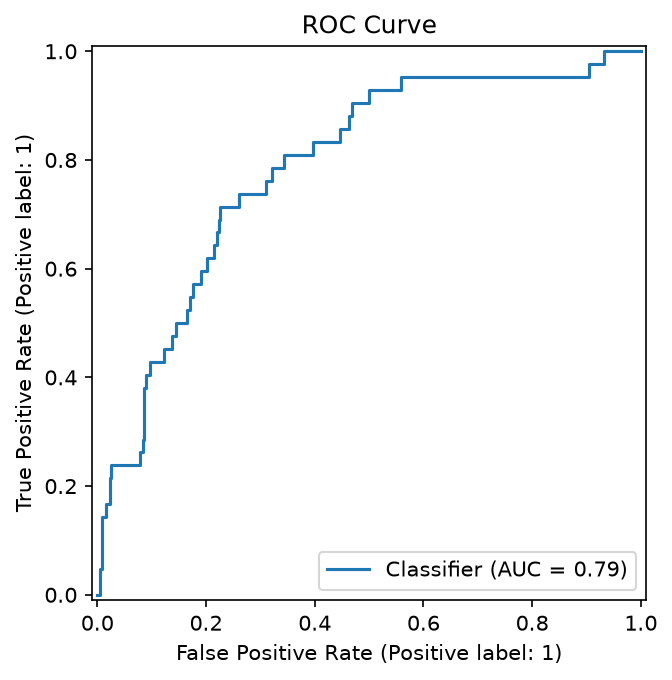
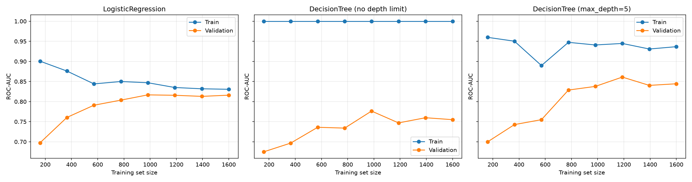

## 🚀 Day 3: Data Loading, Cleaning & Inspection

### **Overview**
Day 3 focuses on robust data ingestion, schema validation, missing value sanitization, and automated unit testing adhering to MLOps best practices (PEP-8 formatting, linting, and safe path guards).

---

### **📁 Core Modules & Files**
* `data_loader.py` - Core script responsible for robust data ingestion, fallback paths, and schema validation.
* `data_cleaning.py` - Handles missing value treatment, null dropping, and dataset sanitization with empty-DataFrame guards.
* `tests/test_data_loader.py` - Unit test suite utilizing `pytest` and `tmp_path` fixtures to validate data loader and cleaner functions.
* `LICENSE` - Open-source MIT License for project distribution.

---

### **⚡ Quick Start & Execution Guide**

1. **Install Dependencies:**
   Ensure your virtual environment is active and required packages are installed:
   ```bash
   pip install -r requirements.txt
   ```

---

## 📊 Day 4: Exploratory Data Analysis (EDA)

### Files
- `eda.py` - runs describe(), info(), null checks and saves all plots
- `observations.md` - 5 observations from the summary stats
- `eda_narrative.md` - 200-word EDA narrative
- `outputs/` - distributions, correlation heatmap, top-10 category charts

---

### Day 5: Data Visualization (Matplotlib & Seaborn)
* **Objective:** Complete hands-on tasks for exploratory data visualization using Matplotlib and Seaborn.
* **Key Tasks Implemented:**
  * Generated distribution plots to analyze data spread and skewness (e.g., Age, Fare).
  * Created categorical comparison and count plots.
  * Developed correlation heatmaps to identify feature relationships.
  * Authored exploratory data analysis (EDA) narratives and observations.
* **Outputs:** Visualizations and plots saved to the project directory.

---

# Week 2 Day 1: Feature Engineering Pipeline (Scaling, Encoding, & Selection)
* **Objective:** Build an end-to-end, leak-free preprocessing and feature selection pipeline using `scikit-learn`.
* **Key Implementations:**
  * **Missing Value Imputation:** Handled numeric columns using median imputation and categorical columns using most-frequent imputation.
  * **Feature Scaling:** Standardized numeric attributes using `StandardScaler`.
  * **Categorical Encoding:** Applied `OneHotEncoder(drop='first')` to prevent the dummy-variable trap.
  * **Feature Selection:** Integrated `SelectKBest(k=5)` directly into a unified `Pipeline` to ensure all transformations fit strictly on the training split, avoiding data leakage.
* **Visualizations & Inspection:**
  * Generated side-by-side histograms comparing raw vs. standard-scaled numeric distributions.
  * Extracted and displayed feature importance scores for the top-selected features.
* **Pull Request:** Merged via PR #5 (`feat: feature engineering – encoding, scaling & top-5 selection`).

---

### Week 2 Day 2: Feature Scaling, SelectKBest, and RFE Tasks

## Overview
Day 2 focuses on advanced feature engineering techniques, examining how different scalers handle skewed distributions and outliers, applying statistical feature selection (`SelectKBest`), and implementing model-driven feature elimination (`RFE`).

## Core Modules & Tasks

* **Task 1: Scalers & Skewed Data**
  * Evaluated and compared `StandardScaler`, `MinMaxScaler`, `RobustScaler`, and `Normalizer`.
  * Handled simulated skewed distributions and outlier-heavy columns to understand scaling trade-offs.

* **Task 2: SelectKBest Feature Selection**
  * Implemented `SelectKBest` using ANOVA F-value (`f_classif`) for standard classification features.
  * Implemented Chi-Square (`chi2`) feature selection on non-negative scaled data using `MinMaxScaler`.

* **Task 3: Recursive Feature Elimination (RFE)**
  * Configured `RFE` utilizing a `LogisticRegression` estimator to recursively rank and eliminate low-importance features.
  * Logged feature support, rankings, and automated elimination summaries.

## Quick Start & Execution Guide

1. **Install Dependencies:** Ensure your environment has the required libraries installed:
   ```bash
   pip install -r requirements.txt
   ```

---

## Week 2 - Day 3: Imbalanced Data Pipeline & MLflow Tracking

### 🚀 What Was Accomplished
* **Imbalanced Dataset Handling:** Implemented a robust `imbalanced-learn` pipeline (`ImbPipeline`) integrating `SMOTENC` to handle mixed numerical and categorical features for class imbalance.
* **Feature Processing Setup:** Configured a `ColumnTransformer` with `StandardScaler` for numerical attributes and an `OrdinalEncoder` for categorical columns.
* **Model Training:** Trained a `RandomForestClassifier` (with 200 estimators and balanced class weights) on the resampled training split.
* **MLflow Tracking Integration:**
  * Set up MLflow tracking experiments (`SMOTE_Imbalanced_Classification`).
  * Logged key parameters (`model`, `n_estimators`, `class_weight`, `smote_k_neighbors`, `random_state`) and performance metrics (`precision macro`, `recall macro`, `f1 macro`).
  * Secured model logging using `skops_trusted_types` to whitelist custom third-party components like `SMOTENC`.
* **Model Serialization:** Successfully exported and saved the end-to-end trained pipeline locally as `smote_rf_pipeline.pkl` for downstream inference.

### 📊 Evaluation Results
* Evaluated model performance on the test set using classification reports, tracking macro averages and class-specific metrics to ensure reliable handling of minority classes.

---

# Week 2 day 4: Train/Test Split, Cross-Validation and MLflow Experiment Tracking

### Task Prompt
Build a reproducible machine learning workflow in Python that:
1. Generates a synthetic classification dataset (1,000 samples, 20 features).
2. Splits it into train and test sets using a **stratified** 80/20 split.
3. Builds a scikit-learn **Pipeline** (`RobustScaler` + `RandomForestClassifier`) so all preprocessing is learned only from the training data (no data leakage).
4. Evaluates the pipeline with **5-fold Stratified Cross-Validation** using `balanced_accuracy`.
5. Trains the final model on the full training set and evaluates it on the unseen test set.
6. Logs parameters, metrics and the trained model to **MLflow**, and compares runs in the MLflow UI.

### Project Structure
```
ai-ml-internship/
├── train_test_cv.py    # training, cross-validation and MLflow logging
├── mlflow.db           # MLflow tracking database (auto-created)
├── mlruns/             # MLflow artifacts (auto-created)
└── README.md
```

### Setup
```bash
python -m venv venv
venv\Scripts\activate
pip install numpy scikit-learn mlflow
```

### How to Run
1. Start the MLflow server (keep this terminal open):
   ```bash
   mlflow ui
   ```
2. In a second terminal, run the script:
   ```bash
   python train_test_cv.py
   ```
3. Open http://127.0.0.1:5000 and go to **Training runs** to view the results.

### What Gets Logged to MLflow
| Type    | Items |
|---------|-------|
| Params  | model, scaler, n_estimators, n_splits_cv, scoring, test_size |
| Metrics | cv_mean_score, cv_std_score, test_balanced_accuracy, test_accuracy |
| Artifact| Trained sklearn pipeline (`model`) |

### Results
| Metric | Value |
|--------|-------|
| CV mean (balanced accuracy) | _fill in_ |
| CV std | _fill in_ |
| Test balanced accuracy | _fill in_ |
| Test accuracy | _fill in_ |

### Key Concepts Practised
- Stratified train/test split to keep class ratios
- Pipelines to prevent data leakage
- Stratified K-Fold cross-validation
- Experiment tracking and model logging with MLflow

### Issues Faced and Fixes
| Problem | Fix |
|---------|-----|
| Runs showed **Failed** with nothing logged | Script had no `mlflow.start_run()` block; added one and logged params, metrics and model |
| `UntrustedTypesFoundException` on `log_model` | Passed `skops_trusted_types=["sklearn.tree._tree.Tree"]` (model was trained by me, so it is trusted) |
| `OpenBLAS error: Memory allocation failed` | Limited threads with `OPENBLAS_NUM_THREADS=1` and set `n_jobs=2` |
| Tracking URI error with `sqlite:///mlflow.db` | Pointed the script to the running server: `mlflow.set_tracking_uri("http://127.0.0.1:5000")` |

---

# Week 2 Day 5 Project: End-to-End Preprocessing Pipeline with SMOTENC & MLflow

## 🚀 Project Overview
This module implements an end-to-end data preprocessing and classification pipeline designed to handle imbalanced datasets using `SMOTENC`, combined with scikit-learn preprocessing transformers and a `RandomForestClassifier`. The workflow also integrates `MLflow` for experiment tracking, parameter logging, and model artifact registration.

---

## 🛠️ Tech Stack & Libraries
* **Python** (3.14+)
* **Scikit-Learn** (`Pipeline`, `ColumnTransformer`, `StandardScaler`, `OneHotEncoder`, `SimpleImputer`)
* **Imbalanced-Learn** (`ImbPipeline`, `SMOTENC`)
* **MLflow** (Experiment tracking & model logging)
* **Pytest** (Automated unit testing)

---

## 📂 Project Structure
* `smote_pipeline.py` — Core implementation of the preprocessor, SMOTENC transformer, postprocessor, and MLflow logging workflow.
* `tests/` or `test_pipeline.py` — Unit tests using `pytest` to validate pipeline fitting and prediction without runtime errors.
* `requirements.txt` — Project dependencies.

---

## 🧪 Running Unit Tests
To verify that the preprocessing pipeline, SMOTENC oversampling, and model predictions execute successfully on mock data, run:
```bash
pytest -v test_pipeline.py
```

---

# Week 3 - Day 1: Advanced Linear Regression & Hyperparameter Tuning

## 🎯 Objective
The objective of this assignment is to move beyond standard baseline models by implementing hyperparameter tuning (`GridSearchCV`) for regularized linear models (**Ridge** and **Lasso**), evaluating performance using robust cross-validation, and tracking model parameters and metrics using **MLflow**.

---

## 🛠️ Project Structure
* `linear_regression_assignment.py`: The complete end-to-end Python script containing data loading, grid search hyperparameter tuning, cross-validation, evaluation metrics, MLflow tracking, and plotting.
* `mlruns/`: Local directory where MLflow logs run parameters, metrics, and model artifacts.

---

## 📊 Key Components Implemented
1. **Dataset Loading**: Automatically loads the real-world **California Housing dataset** via `scikit-learn` (`fetch_california_housing`).
2. **Hyperparameter Tuning (`GridSearchCV`)**:
   * **Ridge Regression (L2 Penalty)**: Tuned across a grid of `alpha` values (`[0.01, 0.1, 1.0, 10.0, 100.0]`) with 5-fold cross-validation.
   * **Lasso Regression (L1 Penalty)**: Tuned across a grid of `alpha` values (`[0.0001, 0.001, 0.01, 0.1, 1.0]`) with increased maximum iterations to ensure convergence.
3. **Model Evaluation & Comparison**: Evaluates models on Test MSE, RMSE, MAE, $R^2$ Score, and Cross-Validation RMSE, compiling results into a clean comparison table.
4. **MLflow Tracking**: Automatically starts an MLflow run, logs the best model name, final RMSE, and $R^2$ metrics, and logs the trained model artifact using updated API conventions (`name="model"`).
5. **Visualization**: Generates dual-panel Matplotlib figures showcasing:
   * **Actual vs. Predicted** scatter plot with an ideal fit reference line.
   * **Residuals Plot** to inspect error distribution and variance patterns.

---

## 🚀 How to Run the Code

1. **Activate your virtual environment** (if not already active):
   ```powershell
   # On Windows PowerShell
   .\venv\Scripts\Activate
   ```
2. **Run the script:**
   ```powershell
   python linear_regression_assignment.py
   ```

---

# Week 3 Day 2: Logistic Regression: Breast Cancer Classification

Binary classification on the scikit-learn Breast Cancer Wisconsin dataset
(30 features; class 0 = malignant, class 1 = benign) using logistic regression.

## Approach
1. Loaded the dataset and split it into train and test sets (114 test samples).
2. **Scaled features with `StandardScaler`.** Logistic regression is sensitive to
   feature scale, and scaling helps the solver converge and keeps coefficients comparable.
3. Trained a logistic regression model on all 30 features.
4. Evaluated on the held-out test set and with 5-fold cross-validation.

## Results

| Metric | Value |
|---|---|
| Accuracy | 0.9561 |
| Precision (class 1) | 0.9855 |
| Recall (class 1) | 0.9444 |
| F1 (class 1) | 0.9645 |
| ROC-AUC | 0.9954 |
| CV accuracy (5-fold) | 0.9754 ± 0.0102 |

### Confusion matrix (test set)

|  | Predicted malignant | Predicted benign |
|---|---|---|
| **Actual malignant** | 41 | 1 |
| **Actual benign** | 4 | 68 |

- 109 of 114 samples classified correctly (5 errors).
- Malignant recall is 0.98: the model catches 41 of 42 malignant cases. In a
  medical setting, missing a malignant case is the costlier error, so this matters most.
- The 4 benign cases predicted as malignant are false alarms, which are generally
  less costly than a missed malignancy.

### ROC curve
AUC = 0.9954. The curve stays near the top-left corner, so the model separates
the classes well across thresholds.

### Decision boundary
The plot uses only the first 2 scaled features, **for visualization only**. The
model itself is trained on all 30 features. The straight boundary reflects that
logistic regression is a linear classifier. The overlap near the line is why
2 features alone would score much lower than the full model.

## Notes
- CV accuracy (0.975) is slightly above test accuracy (0.956). On a test set this
  small, one sample shifts accuracy by about 0.9%, so the gap is expected.
- Possible next steps: tune the regularization strength `C`, compare with other
  models (SVM, Random Forest), and adjust the decision threshold to prioritize recall.

## Run
```bash
pip install scikit-learn matplotlib seaborn numpy
python logistic_regression.py
```

---

# Week 3 Day 3: Decision Trees & Random Forests

## Overview
Trains Decision Trees and a Random Forest on the scikit-learn Breast Cancer
dataset (80/20 split, `random_state=42`) and tracks every run with MLflow
(AI/ML 3M stack).

## Files
- `w3d3_trees.py` - main script. Trains Decision Trees with `gini` and `entropy`
  at `max_depth` None, 2, 3, 5 and 8, and logs params and metrics (`train_acc`,
  `test_acc`, `gap`) to the MLflow experiment `w3d3-decision-trees`. Saves a
  depth-3 tree plot, then trains a Random Forest (100 trees, `max_depth=5`) and
  logs `rf-model` and `tree.png` as artifacts.
- `test_w3d3.py` - 3 pytest tests.
- `tree.png` - depth-3 tree visualisation.

## How to Run
```bash
pip install scikit-learn matplotlib mlflow pytest
python w3d3_trees.py
pytest test_w3d3.py -q
mlflow ui   # http://127.0.0.1:5000
```

## Results
| Model | Train acc | Test acc | Note |
|---|---|---|---|
| Decision Tree, unlimited depth | 1.000 | 0.947 | Overfitting |
| Decision Tree, gini, depth 3 | 0.978 | 0.947 | |
| Decision Tree, entropy, depth 3 | 0.980 | 0.965 | |
| Random Forest (100 trees, depth 5) | 0.993 | 0.965 | |

## Key Learnings
- Gini vs entropy: information gain is the drop in impurity after a split.
- Overfitting: an unlimited-depth tree memorises the training data (train 1.000,
  test 0.947). Limiting `max_depth` reduces the train/test gap.
- Random Forest reduces variance by averaging many trees.

---

# Week 3 Day 4: SVM vs KNN - When to Use What

## What I did
Compared SVM and KNN on the breast cancer dataset using GridSearchCV
(5-fold CV, scoring = f1_weighted) and logged all runs to MLflow.
Three experiments: SVM (scaled), KNN (scaled), KNN (unscaled).

## Results
| Model | Accuracy | F1 (weighted) | Fit time (s) | Predict time (s) | Best params |
|---|---|---|---|---|---|
| SVM scaled | 0.982 | 0.982 | 0.80 | 0.0014 | C=0.1, kernel=linear |
| KNN scaled | 0.974 | 0.973 | 0.61 | 0.0049 | n_neighbors=7, weights=uniform |
| KNN unscaled | 0.912 | 0.913 | 0.53 | 0.0044 | n_neighbors=5, weights=distance |

## Observations
- Scaling improved KNN accuracy from 0.912 to 0.974. KNN is distance-based,
  so features with large numeric ranges dominate the distance when the
  data is not scaled.
- SVM gave the best accuracy (0.982) and the fastest prediction, but it
  took slightly longer to fit than KNN. KNN has almost no training cost
  but is slower at prediction time.
- The best SVM kernel was linear, which suggests this dataset is close to
  linearly separable.
- The timings are very small because the dataset is small, so the speed
  differences are only indicative.

## When to use what
- **KNN:** small, low-dimensional data. No training step, but slow at
  prediction time, and it needs feature scaling.
- **SVM:** high-dimensional data, and non-linear boundaries through
  kernels. Slow on very large datasets, and it needs scaling and tuning
  of C and the kernel.

## How to run
```bash
pip install -r requirements.txt
python svm_knn_comparision.py
mlflow ui   # then open http://127.0.0.1:5000
```

## Reproducibility
- Random seed: 42 (train/test split, stratified 80/20)
- Cross-validation: 5 folds, scoring = f1_weighted

## MLflow artifacts
Each run logs its best hyperparameters, metrics (accuracy, f1_weighted,
fit and predict time) and the best model under "model".  

## W3D5 task: Hyperparameter Tuning
with GridSearchCV and RandomizedSearchCV. I will add it to the bottom of my
existing README, so start with a "## W3D5: Hyperparameter Tuning" heading
and do not write a full project README.

Details to use:
- Files: hyperparameter_tuning.py (main script), test_tuning.py (pytest sanity test)
- Dataset: Iris, 80/20 stratified split, random_state=42
- Models: SVM (SVC) and KNN, each inside a Pipeline with StandardScaler
- Methods: GridSearchCV and RandomizedSearchCV (5-fold CV, n_iter=20 for random search)
- Tracking: MLflow with a local SQLite backend (sqlite:///mlflow.db);
  logs best params, best_cv_score, test_accuracy and the best model
- Results:
  | Run | CV score | Test accuracy |
  | SVM-GridSearch | 0.975 | 0.933 |
  | SVM-RandomSearch | 0.975 | 1.000 |
  | KNN-GridSearch | 0.967 | 0.933 |
  | KNN-RandomSearch | 0.975 | 0.900 |
- How to run:
  python hyperparameter_tuning.py
  mlflow ui --backend-store-uri sqlite:///mlflow.db
  pytest test_tuning.py

Include these sections: Overview, Files, Setup, How to Run, Results (table),
Key Learnings (3 or 4 short bullets: GridSearch vs RandomSearch, why scaling
matters for SVM and KNN, why a Pipeline avoids data leakage, small test set
of 30 samples means one wrong prediction changes accuracy by about 3%).

Keep it short, simple and beginner-friendly. Do not invent any numbers
beyond the ones I gave.  

# W4D1: Model Evaluation Metrics - Precision, Recall, AUC

AI/ML Internship - Week 4, Day 1

## Overview

This mini-project shows how accuracy can be misleading on an imbalanced binary classification problem (90% class 0, 10% class 1).

What it covers:

1. Train a Logistic Regression, with and without class-weight balancing.
2. Report precision, recall, F1, ROC-AUC and PR-AUC together with a confusion matrix.
3. Compare KFold vs StratifiedKFold cross-validation on the same data.
4. Use learning curves to diagnose overfitting vs underfitting for Logistic Regression and two Decision Tree variants.
5. Log parameters, metrics and plots to an MLflow experiment.

## Project Structure

```
.
├── eval_metrics.py      # data generation, model training, evaluation and plots
├── cv_analysis.py       # KFold vs StratifiedKFold and learning curves
├── mlflow_logging.py    # logs params, metrics and plots to MLflow
├── test_metrics.py      # 3 pytest tests
├── .gitignore
└── README.md
```

Generated plots (saved in the project folder): `confusion.png`, `roc.png`, `pr.png`, `learning_curve.png`.

## Setup

Windows PowerShell:

```powershell
python -m venv venv
venv\Scripts\activate
pip install scikit-learn pandas matplotlib mlflow pytest
```

## How to Run

Run the scripts in this order so the plots exist before MLflow logs them:

```powershell
python eval_metrics.py      # metrics, confusion matrix, ROC and PR plots
python cv_analysis.py       # cross-validation and learning curves
python mlflow_logging.py    # logs to experiment "w4d1-model-evaluation"
pytest -v                   # 3 tests
mlflow ui                   # open http://127.0.0.1:5000
```

`eval_metrics.py` evaluates one model per run. To switch between the two settings below, change `train_model()` to `train_model(balanced=True)` inside `main()` and run it again.

## Results

### 1. Logistic Regression evaluation

| Setting | Accuracy | Class-1 Precision | Class-1 Recall | ROC-AUC | PR-AUC | Confusion Matrix |
|---|---|---|---|---|---|---|
| Without class weighting | 0.90 | 0.50 | 0.05 | 0.7965 | 0.3809 | [[356, 2], [40, 2]] |
| `balanced=True` | 0.72 | 0.23 | 0.74 | 0.7874 | 0.3176 | [[256, 102], [11, 31]] |

Accuracy looks high (0.90) but the unweighted model almost always predicts the majority class and finds only 2 of 42 real positives. Class weighting lowers accuracy but raises recall from 0.05 to 0.74, at the cost of more false alarms (FP 2 to 102).

### 2. Cross-validation (5-fold)

| Splitter | ROC-AUC (mean +/- std) | Precision std |
|---|---|---|
| KFold | 0.810 +/- 0.034 | 0.070 |
| StratifiedKFold | 0.816 +/- 0.022 | 0.128 |

Mean scores are almost the same. StratifiedKFold gave a more stable ROC-AUC (lower std) because every fold keeps the 90/10 class ratio. Its precision std was not lower, because the model predicts very few positives (recall about 0.04), so precision is computed from only a few predictions per fold.

### 3. Learning curves (final ROC-AUC)

| Model | Train | Validation | Diagnosis |
|---|---|---|---|
| Logistic Regression | 0.831 | 0.816 | Small gap, limited capacity |
| Decision Tree (no depth limit) | 1.000 | 0.755 | Overfitting |
| Decision Tree (max_depth=5) | 0.937 | 0.844 | Regularisation reduces overfitting |

## Key Learnings

- Accuracy alone is misleading on imbalanced data. Always check precision, recall and F1.
- Precision-recall trade-off: catching more positives usually means more false alarms.
- Prioritise recall when missing a positive is costly (for example fraud detection or medical screening).
- PR-AUC is often more informative than ROC-AUC when the positive class is rare.
- Stratified cross-validation keeps class ratios in every fold.
- Learning curves show overfitting (high train, low validation) and underfitting (both low).

## Screenshots




## Tech Stack

Python, scikit-learn, matplotlib, MLflow, pytest