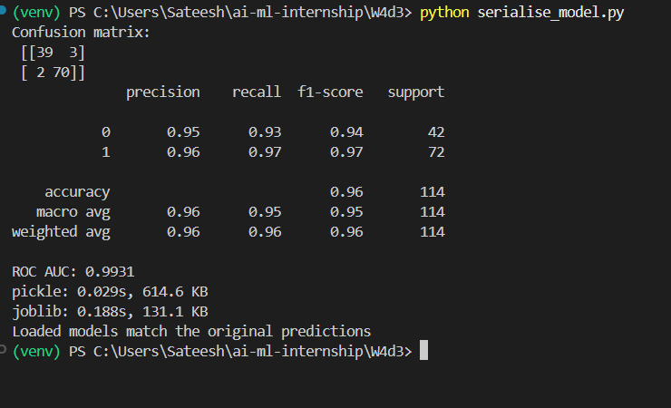

# W4D3: Model Serialisation (pickle & joblib)

*Objective:* Demonstrate model persistence with pickle and joblib and compare their speed and size.

## How to run
```
pip install scikit-learn joblib numpy
python serialise_model.py
```

## Results
- Accuracy: 0.96 (109 of 114 correct)
- ROC AUC: 0.9931
- Confusion matrix: [[39, 3], [2, 70]]

## pickle vs joblib
| Method | Save time | File size |
|--------|-----------|-----------|
| pickle | 0.029 s | 614.6 KB |
| joblib (compress=3) | 0.188 s | 131.1 KB |

joblib produced a file about 4.7x smaller because of compression, at the cost of a slower save. pickle is fine for small models; joblib is better for large models with big NumPy arrays. Both reloaded models gave predictions identical to the original.

## Notes
- Never load pickle/joblib files from untrusted sources (arbitrary code execution).
- Load with the same scikit-learn and Python versions used to save.

## Output


## Future work
- Log metrics and the model to MLflow
- Add a pytest check for the reload-verification step

## Self-review checklist
- [x] Code runs without errors
- [x] Comments/docstrings added
- [x] Both pickle and joblib save/load tested
- [x] Predictions verified after reload
- [x] CIA review done (2 interactions)
- [x] Output screenshot included=