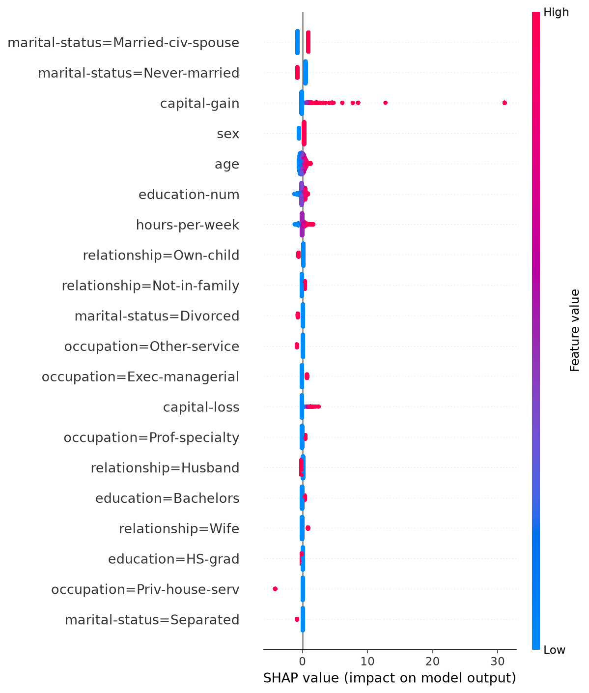

# Model Card: Income Prediction (Logistic Regression)

**Name:** Adult Income Classifier v1 | **Date:** 26 Nov 2026 | **Author:** Chaithanya Pasupuleti

## Model Details
Logistic Regression (scikit-learn), plus a Reweighing-mitigated variant.

## Intended Use
Learning exercise on bias auditing. **Not** for real hiring, lending or credit decisions.

## Factors
Gender (audited: male = privileged, female = unprivileged). Race and age are model features but were not audited.

## Metrics
Accuracy, Disparate Impact (DI), Statistical Parity Difference (SPD), Average Odds Difference (AOD).

## Evaluation and Training Data
UCI Adult Income (1994 US Census), 70/30 train/test split (seed 42). 3,620 rows with missing values removed. Original dataset DI by gender = 0.363.

## Quantitative Analyses

<table>
<tr><th>Metric</th><th>Before</th><th>After Reweighing</th></tr>
<tr><td>Accuracy</td><td>0.846</td><td>0.840</td></tr>
<tr><td>Disparate Impact</td><td>0.316</td><td>0.642</td></tr>
<tr><td>Stat Parity Diff</td><td>-0.183</td><td>-0.077</td></tr>
<tr><td>Avg Odds Diff</td><td>-0.093</td><td>0.085</td></tr>
</table>

`sex` ranks 4th in SHAP importance, after marital status and capital gain.

## Ethical Considerations
- Raw data DI of 0.363 fails the four-fifths rule (0.8). Reweighing improved test DI to 0.642, still below 0.8.
- Marital status and relationship features likely act as proxies for gender.

## Caveats
- 1994 US data, not valid for Indian populations or current conditions.
- Only gender was audited, using DI, SPD and AOD. Only Reweighing was tried.
- Not suitable for production use.